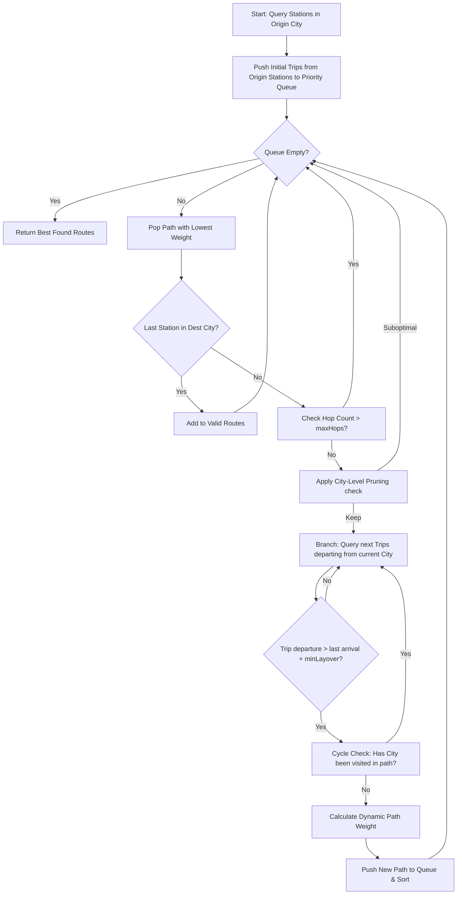

# Tripline — Graph-Based Travel Planner & Booking System (Full Architecture & Implementation Guide)

This guide provides an in-depth breakdown of the architecture, algorithms, database designs, concurrency controls, and deployment pipelines of **Tripline**. It answers your questions regarding how the system operates under the hood, why specific design choices were made, and how they map to the codebase.

---

## Table of Contents
1. [Graph-Based Architecture: How, Why, & Where](#1-graph-based-architecture-how-why--where)
2. [Custom Schedule-Aware Dijkstra Routing](#2-custom-schedule-aware-dijkstra-routing)
3. [Redis TTL-Based Seat Locking (Concurrency Control)](#3-redis-ttl-based-seat-locking-concurrency-control)
4. [Dockerized AWS Deployment (EC2, Nginx, & SSL)](#4-dockerized-aws-deployment-ec2-nginx--ssl)
5. [Stripe Payment Integration & Webhook Lifecycle](#5-stripe-payment-integration--webhook-lifecycle)

---

## 1. Graph-Based Architecture: How, Why, & Where

### Why a Graph?
Traditional relational databases are excellent at searching for direct connections (e.g., flight from Delhi to Mumbai). However, when a user wants to travel from **City A** to **City B** and there is no direct path, the travel planner must solve a **multi-hop route search**. 

Travel networks are natural graphs:
*   **Nodes ($V$):** Physical transit stations, airports, or bus terminals.
*   **Edges ($E$):** Scheduled trips (flights, trains, bus rides) connecting these stations.
*   **Weights ($W$):** Dynamic cost metrics that change based on price, travel duration, or transfers.

### How is it Modeled?
Tripline models this using an Oracle SQL relational database representing a graph structure:
1.  **Nodes:** Stored in the `STATIONS` table.
    *   Each station belongs to a specific city and has coordinates, type (Airport, Train Station, Bus Stand), and active status.
2.  **Edges:** Stored in the `TRIPS` table.
    *   An edge is defined by `ORIGIN_STATION_ID`, `DESTINATION_STATION_ID`, `DEPARTURE_TIME`, `ARRIVALTIME`, `TRANSPORT_MODE` (FLIGHT, BUS, TRAIN), `PRICE`, and `AVAILABLE_SEATS`.
    *   Unlike classical mathematical graphs where edges are static lines, these edges are **time-dependent (scheduled)**. A connection can only be traversed if the traveler arrives at the node *before* the edge departs.

### Where is it Linked in the Project?
*   **Graph Traversals:** Handled entirely in the server service file [routerService.js](file:///c:/Users/evanc/Desktop/Tripline_v2/server/src/services/routerService.js).
*   **Endpoints:** Routed via [searchRoutes.js](file:///c:/Users/evanc/Desktop/Tripline_v2/server/src/routes/searchRoutes.js) to the `searchController.js` and resolved using `routerService.findRoutes()`.
*   **Schema Definition:** The tables supporting the node-edge relation are set up in [schema.sql](file:///c:/Users/evanc/Desktop/Tripline_v2/server/schema.sql) and [dbReset.js](file:///c:/Users/evanc/Desktop/Tripline_v2/server/src/config/dbReset.js).

---

## 2. Custom Schedule-Aware Dijkstra Routing

### What does "Custom Dijkstra" mean?
Standard **Dijkstra's Algorithm** finds the shortest path between nodes in a graph by accumulating static weights. However, a standard Dijkstra algorithm cannot be applied to transit networks because:
1.  **Time Dependencies:** If you arrive at an airport at 2:00 PM, you cannot take a connecting flight that departed at 1:00 PM. The edge traversal is valid *only* if the departure time is in the future relative to the current location's arrival time.
2.  **Layovers & Transfers:** There must be a minimum buffer time (e.g., 2 hours) to allow passengers to deboard, transfer luggage, and clear security.
3.  **Multi-Modal Transitions:** Transitions between different modes (e.g., flight to train) carry weight penalties representing passenger inconvenience.

Tripline implements a **Custom Schedule-Aware Dijkstra (Uniform Cost Search)** that explores paths using a **Priority Queue**, sorting candidate paths by dynamically calculated weights rather than simple distance.

### The Algorithm Workflow
The algorithm is implemented in `findRoutes()` in [routerService.js](file:///c:/Users/evanc/Desktop/Tripline_v2/server/src/services/routerService.js):



### Weight Optimization Modes
The weight of a path is not hardcoded; it is computed dynamically by `calculateWeight()` using three optimization modes:
1.  **`CHEAPEST`**:
    $$W = \sum \text{Price of each leg}$$
2.  **`FASTEST`**:
    $$W = \text{Total Journey Duration (minutes)} + (\text{Waiting Time before departure} \times 0.5)$$
    *This measures the time from the search start window to when the passenger finally arrives, penalizing routes that sit idle for hours before starting.*
3.  **`BALANCED` (Default)**:
    $$W = \text{Total Price} + (\text{Total Duration} \times 2.0) + ((\text{Number of Transfers}) \times 50.0)$$
    *This balances financial cost against journey speed and introduces a **50-unit transfer penalty** to discourage paths with too many layovers.*

### Code Highlights from `routerService.js`
*   **Priority Queue Sorting:** After pushing new paths, the queue is re-sorted:
    ```javascript
    queue.sort((a, b) => a.weight - b.weight);
    ```
*   **Pruning Optimization:** To prevent state-space explosion (exploring hundreds of slow routes), Tripline uses a city-level pruning map `bestWeightToCity`:
    ```javascript
    const prevBest = bestWeightToCity.get(cityKey);
    if (prevBest !== undefined && prevBest < currentPath.weight * 0.6) {
      continue; // Prune this branch if it is significantly worse than a known route
    }
    bestWeightToCity.set(cityKey, currentPath.weight);
    ```
*   **Layover Enforcement:** The connecting trip must depart after the current trip's arrival time plus a buffer:
    ```javascript
    const minNextDeparture = new Date(new Date(lastLeg.arrivalTime).getTime() + minLayoverMinutes * 60000);
    ```

---

## 3. Redis TTL-Based Seat Locking (Concurrency Control)

### The Double-Booking Race Condition
In travel systems, a major vulnerability is **double-booking**. If two users click "Book Seat 12A" at the exact same millisecond, they both proceed to payment, leading to double-allocation. 

To solve this, Tripline implements a **Distributed Seat Locking mechanism** using **Redis TTL-based key-value storage**.

```
User A (Tries to lock Seat 12A)  ──>  Redis: SET seat_lock:101:12A UserA NX EX 300 ──> Returns 'OK' (Success)
User B (Tries to lock Seat 12A)  ──>  Redis: SET seat_lock:101:12A UserB NX EX 300 ──> Returns null (Fails - Seat locked)
```

### What actually happens?
1.  When a user selects a seat in the React UI, the frontend calls the `/api/seats/lock` endpoint.
2.  The server generates a unique lock key: `seat_lock:<tripId>:<seatNo>`.
3.  It runs the Redis atomic command:
    ```javascript
    const acquired = await redis.set(redisKey, userId, { NX: true, EX: 300 });
    ```
    *   **`NX: true` (Not Exists):** Redis will set the key *only* if it does not already exist. If it exists, the command returns `null` (lock fails).
    *   **`EX: 300` (Expiry):** Sets a Time-To-Live (TTL) of 300 seconds (5 minutes). If the user leaves the checkout or their internet disconnects, the lock is automatically deleted by Redis after 5 minutes, preventing permanent lockouts.
4.  If the lock is acquired, the server updates the status in the Oracle DB to `LOCKED` with a `locked_until` timestamp.
5.  If payment is successful, the lock is deleted and updated in SQL to `BOOKED`. If payment is cancelled or the lock expires, the seat is returned to `AVAILABLE`.

### Package and Client Setup
*   **Library:** Official Node Redis driver (`redis` version `^6.0.0`, matching the v4 API specification).
*   **Initialization & Fallback:** Located in [redis.js](file:///c:/Users/evanc/Desktop/Tripline_v2/server/src/config/redis.js). If Redis server goes offline, the system automatically falls back to an in-memory `Map` cache simulation (`memoryFallbackClient`) with self-pruning expiries to prevent the application from crashing.
*   **Lock Code:** Implemented in `lockSeat()`, `unlockSeat()`, and `confirmSeatBooked()` in [seatManagementService.js](file:///c:/Users/evanc/Desktop/Tripline_v2/server/src/services/seatManagementService.js).

---

## 4. Dockerized AWS Deployment (EC2, Nginx, & SSL)

The project is containerized using Docker to guarantee that the environment in production on AWS EC2 matches local development exactly. 

### Multi-Stage Dockerfiles
To keep production images lightweight and secure, Tripline uses **Multi-stage builds**.

#### 1. Backend: [Dockerfile](file:///c:/Users/evanc/Desktop/Tripline_v2/server/Dockerfile)
*   **Stage 1 (Builder):** Uses `node:20-alpine`, copies the full source code, and runs `npm ci` to install all dependencies (including dev tools like nodemon).
*   **Stage 2 (Production):** Uses a clean `node:20-alpine` image. It installs `dumb-init` (to handle Docker termination signals and shut down the Node process gracefully without dangling connections) and creates a secure non-root user `tripline`. It copies *only* the required `node_modules` and runs the server using `dumb-init node src/app.js`.

#### 2. Frontend: [Dockerfile](file:///c:/Users/evanc/Desktop/Tripline_v2/client/Dockerfile)
*   **Stage 1 (Builder):** Installs npm packages and runs `npm run build` to compile the React/Vite code into static HTML/JS/CSS assets inside `/app/dist`.
*   **Stage 2 (Production):** Uses a lightweight `nginx:1.27-alpine` image, copies the static folder (`dist`) to `/usr/share/nginx/html`, and configures Nginx to serve the single-page application.

---

### Production reverse proxy & load balancer
On the AWS EC2 instance, a parent Nginx container ([nginx.conf](file:///c:/Users/evanc/Desktop/Tripline_v2/nginx/nginx.conf)) is exposed to the internet on port 80 (HTTP) and 443 (HTTPS). It acts as the gateway:

1.  **API Routing:** Requests matching `/api/` are forwarded to the Node.js backend pool:
    ```nginx
    location /api/ {
        proxy_pass http://backend_pool;
        proxy_http_version 1.1;
        ...
    }
    ```
2.  **SPA Routing:** Requests matching the frontend are routed to the frontend Nginx web server, which handles deep-linking routing using:
    ```nginx
    location / {
        try_files $uri $uri/ /index.html;
    }
    ```
3.  **SSL/TLS Termination:** Directs secure traffic using Let's Encrypt certificates symlinked from `/etc/letsencrypt/` on the host to `nginx/ssl/`.
4.  **Rate Limiting:** Protects the servers from Denial-of-Service (DoS) attacks by defining request throttling rules:
    ```nginx
    limit_req_zone $binary_remote_addr zone=general:10m rate=10r/s;
    limit_req_zone $binary_remote_addr zone=api:10m rate=5r/s;
    ```

---

### How Deployments Work on AWS EC2
A production deployment guide is detailed in [DEPLOYMENT.md](file:///c:/Users/evanc/Desktop/Tripline_v2/DEPLOYMENT.md) and [UPDATE_SERVER.md](file:///c:/Users/evanc/Desktop/Tripline_v2/UPDATE_SERVER.md).

#### Deployment Workflow:
1.  **Develop:** Code changes are completed on the developer's laptop.
2.  **Push:** Changes are pushed to GitHub (`git push`).
3.  **SSH Log In:** The developer logs into the EC2 instance via SSH:
    ```bash
    ssh -i "tripline-key.pem" ubuntu@3.110.87.94
    ```
4.  **Pull & Restart:** On the EC2 terminal, they pull the latest code and trigger Docker Compose:
    ```bash
    cd ~/Tripline_v2
    git pull
    docker compose -f docker-compose.local.yml up --build -d
    ```
    *   This rebuilds the images with the updated code, starts the containers, runs healthchecks, and mounts the runtime configurations.

#### Configuring SSL (HTTPS) on EC2:
1.  Stop the web services temporarily so port 80 is open.
2.  Install Certbot and run standalone verification to fetch SSL certificates from Let's Encrypt:
    ```bash
    sudo certbot certonly --standalone -d yourname.duckdns.org
    ```
3.  Symlink the keys directly to the Nginx config path:
    ```bash
    sudo ln -sf /etc/letsencrypt/live/yourname.duckdns.org/fullchain.pem ~/Tripline_v2/nginx/ssl/fullchain.pem
    sudo ln -sf /etc/letsencrypt/live/yourname.duckdns.org/privkey.pem ~/Tripline_v2/nginx/ssl/privkey.pem
    ```
4.  Switch Nginx configurations to use the production version (SSL enabled on 443) and boot the containers.

---

## 5. Stripe Payment Integration & Webhook Lifecycle

The Stripe payment integration handles secure purchases without storing credit card details on Tripline servers.

### Stripe Checkout Flow

```
1. Frontend ── POST /api/payment/checkout ──> 2. Backend ── Create Stripe Session ──> 3. Stripe API
                                                                                            │
5. Redirects to Stripe Portal <── Returns Session URL 4. ◄──────────────────────────────────┘
            │
   (User enters Card Details)
            │
6. Stripe Redirects ──> Success URL /booking-confirmation
            │
            └───────────────> 7. Stripe Webhook (checkout.session.completed) ──> 8. Tripline Backend
                                                                                            │
                                                                                 (Mark Paid, Book Seats,
                                                                                  Generate QR & Send PDF)
```

### Detailed Steps:
1.  **Checkout Session Creation:**
    *   Inside [paymentService.js](file:///c:/Users/evanc/Desktop/Tripline_v2/server/src/services/paymentService.js), `createCheckoutSession()` is invoked.
    *   It calculates the booking price from the database, converts the amount to the minor unit in INR (paise: e.g., $\text{Price} \times 100$), and registers a new Stripe Checkout Session.
    *   It attaches the `bookingId` inside the Stripe session `metadata`.
    *   It redirects the client browser to the secure Stripe hosting payment page.
2.  **Stripe Webhook Listener:**
    *   Once the customer pays, Stripe sends a POST webhook to `/api/payment/webhook`.
    *   The backend validates the signature (`stripe.webhooks.constructEvent`) to ensure the request genuinely came from Stripe using `STRIPE_WEBHOOK_SECRET`.
    *   It extracts the `bookingId` from the metadata.
    *   It updates the booking status in the Oracle DB to `PAID`, decrements available seats in the `TRIPS` table, releases the Redis seat lock, and updates the database seat status from `LOCKED` to `BOOKED`.
3.  **PDF Receipt and QR Code Ticket Generation:**
    *   A unique verification ticket QR code is generated:
        `TRIPLINE|TICKET:<id>|BOOKING:<id>|PASSENGER:<name>|SEAT:<seat>`
    *   [pdfGenerator.js](file:///c:/Users/evanc/Desktop/Tripline_v2/server/src/utils/pdfGenerator.js) uses `pdfkit` to compile a boarding pass PDF with the embedded QR code.
    *   The backend emails the PDF boarding passes to the user using `nodemailer` and sends a separate payment receipt invoice.
